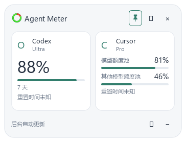

# Agent Meter

Windows 原生半透明悬浮窗，用于集中显示个人 Agent 套餐额度。正式应用没有“演示”标识，也没有模拟用量。



截图使用示例读数。支持选择显示的 Agent、多个额度窗口、迷你条及原地刷新。

## 运行

双击 `dist/AgentMeter.exe`。无需管理员权限，也无需额外安装 Python。本机 Codex 官方组件用于读取 Codex 额度和完成 OAuth；Claude 可独立使用浏览器 OAuth，不需要安装 Claude Code，状态栏采集仍为可选方式。

GitHub 仓库提供源码，`dist/` 是本地构建输出，不纳入版本控制。从源码运行与生成 EXE 的步骤见下方“开发与验证”。

窗口右上角 × 隐藏到托盘；托盘菜单退出。`Ctrl + Alt + M` 显示 / 隐藏；如果快捷键被其他程序占用，可以使用托盘图标。

- 拖动顶部标题或空白背景移动悬浮窗。
- 每个 Agent 是可拖动的方格。点击查看详情；方向键也可调整排序。
- 额度刷新会原地更新数值、进度条和状态，不重建主窗口；迷你条与已打开的详情窗口也会保留位置和布局。
- 检测到读数过期时会立即补刷一次（每 5 秒检查，休眠唤醒后也适用）。补刷失败或仍返回过期窗口时保留旧读数，等待下一次定时刷新；成功取得有效读数后恢复过期检测。
- Cursor 额度接口允许最多 60 秒的响应等待，以兼容服务端慢请求。服务异常、请求限流和响应超时分别提示；发生错误时保留上次真实额度，等待自动刷新。
- 设置 → 显示 → 显示的 Agent，可选择要显示的工具（至少 1 项）。隐藏的 Agent 同时从主窗口和迷你条移除，并暂停自动采集及提醒；之后可重新勾选。
- 方格可同时显示最多 3 个额度窗口及各自进度，更多窗口会显示剩余项数；迷你条显示前 2 个窗口，点击可在详情查看全部额度与重置时间。
- − 收起为单行迷你条，↗ 展开。设置里选择 1–3 个重点 Agent，跟随主窗口顺序。
- 紧凑 2×2 与横向 4 个方格可切换，支持浅色 / 深色 / 跟随系统、置顶、背景透明度、开机启动和低额度提醒。
- 设置 → 网络只配置一个共享代理（系统代理或自定义 HTTP / HTTPS / SOCKS5 地址），勾选哪些 Agent 使用它。未勾选的 Agent 直连，并清除其子进程继承的代理环境变量。默认勾选 Cursor、Codex、Claude。代理不应带用户名和密码。
- 代理用于本工具的采集请求与它启动的登录组件；外部浏览器、已运行的客户端仍使用自身网络设置。豆包独立额度查询使用共享代理的选择，下次刷新立即生效。备用桌面版连接的代理通过启动参数传入，本机额度连接始终直连。
- 旧版独立代理设置会迁移为共享代理：同地址的自定义代理一起保留；若旧版配置了不同地址，使用首个地址，仅选中原来使用该地址的 Agent。请在网络页检查选择。

## 登录与连接管理

设置 → 接入，或 Agent 详情 → 连接管理。优先复用本机客户端登录状态；没有可用登录时提供各工具的登录入口。

| 工具 | 当前登录方式 | 限制 |
| --- | --- | --- |
| Cursor | 自动只读本机登录；按钮打开 Cursor 客户端进行登录 | 网页登录本身不会把登录状态同步到本工具 |
| Codex | 自动复用本机登录；支持通过官方 App Server 启动浏览器 OAuth | 支持 PATH 中的 Codex CLI 与桌面版自带的官方组件；关闭连接窗口会取消待完成的登录 |
| Claude | 独立浏览器 OAuth；没有本工具授权时只读有效的本机 Claude Code 登录 | 无需安装 CLI；使用内部接口，官方未承诺第三方兼容性 |
| 豆包 | 只读复用本机登录，独立 HTTP 查询订阅额度；桌面版连接为备用方式 | 首次复用需登录后退出一次，随后无需保持豆包运行；不是第三方 OAuth，扫码登录尚未实现 |

Codex OAuth 的回调和凭据存储由官方组件完成，悬浮窗只接收登录地址与完成状态。该流程已验证能够启动官方认证地址并取消；真实重新登录需用户在浏览器完成授权。应用不会自动退出当前账号。
如果浏览器没有自动打开，连接管理会显示“复制登录链接”，可将官方授权链接粘贴到浏览器继续登录。

Claude OAuth 参考 [claude-usage-bar-windows](https://github.com/character-s/claude-usage-bar-windows/blob/master/usage_service.py) 的协议，独立实现浏览器 PKCE 授权及令牌刷新。它使用现有客户端 OAuth 配置与内部用量接口，不是官方开放的第三方 SDK；[官方认证与凭据说明](https://code.claude.com/docs/en/legal-and-compliance#authentication-and-credential-use)仍限制第三方 Claude.ai 登录。接口可能变化，单纯登录成功也不保证账号返回额度。

连接管理 → 浏览器 OAuth 登录 → 在浏览器授权 → 把授权码（或完整回调地址）粘贴回窗口 → 完成登录。支持校验授权码携带的 state，PKCE 随机校验值绑定当前登录；10 分钟超时，关闭窗口取消待完成授权。浏览器使用自己的网络配置，令牌交换、刷新与用量请求使用共享代理中 Claude 的选择。

本工具自己的令牌优先于本机登录，允许独立切换账号。令牌过期前自动刷新，401 最多刷新并重试一次；429 按 Retry-After 与递增间隔暂停请求，保留旧读数。不会发送模型请求探测额度。移除本工具授权只删除本工具令牌，不退出原客户端；本机有效登录仍可自动复用。

## 当前接入情况

| 工具 | 数据来源 | 更新方式 |
| --- | --- | --- |
| Cursor | 本机 Cursor 的只读登录状态 + 客户端 `GetCurrentPeriodUsage` 接口 | 默认每 5 分钟，读取分别返回的模型额度池 |
| Codex | 本机 Codex CLI 登录 + 官方 `account/rateLimits/read` | 默认每 5 分钟，以账号返回的窗口与重置时间为准 |
| Claude | OAuth `/api/oauth/usage` 返回的 5 小时、7 天及可用的模型额度窗口 | 默认每 5 分钟；没有有效 OAuth 登录时可回退到状态栏快照或手动录入 |
| 豆包 | 独立 HTTP 查询个人 `membership` 订阅额度；可回退到桌面版额度服务 | 默认每 5 分钟；客户端关闭后仍可刷新；显示时段及周期额度、重置时间；失败可回退到明确标注的手动录入 |

本机实际验证过 Cursor 的两个额度池、Codex 的 7 天窗口，以及豆包桌面版 2.31.4 返回的 5 小时、7 天额度与重置时间。Claude OAuth 已验证 PKCE、状态校验、取消、加密存储、令牌刷新及用量解析；网络协议使用受控响应验证，真实账号授权和真实 Claude 额度尚未验证。没有返回窗口时明确显示未知。可选状态栏方式需要已安装并登录的 Claude Code 新会话返回 `rate_limits`。应用不会主动发起付费模型请求。

豆包：在官方客户端登录并退出一次，然后在本工具刷新，或详情 → 连接管理 → 复用本机登录并刷新。已验证客户端完全关闭时，独立查询仍能读取同一账号的 5 小时、7 天窗口及重置时间。本工具只读豆包域名下必要的登录 Cookie，不复制浏览器资料、不读取聊天；会话经 Windows DPAPI 加密保存在本机。客户端运行导致登录库锁定时使用已加密保存的会话；登录失效时提示在官方客户端重新登录，不把未知额度显示为 100%。

独立查询参考 [AskDoubao 的会话与 HTTP 协议](https://github.com/OxygenAILab/AskDoubao)，仅调用 `/alice/commerce/sale/subscription/quota/summary/`，请求个人 `membership` 额度，不调用生成接口或读取账单。额度缓存只接收白名单字段；保留“不到 1%”精度及未知状态，不直接采用参考项目的图片、视频分类。

备用桌面版采集参考 [doubao-cli 的额度协议](https://github.com/Fullstop000/doubao-cli/blob/main/src/usage.mjs)，通过 `127.0.0.1:9225` 调用已有的额度服务。“启动豆包并连接”只启动已退出的客户端，不自动终止进程，也不修改豆包快捷方式或持久配置。这两种方式均使用内部协议，客户端或网页更新可能影响采集。

豆包返回“已用不到 1%”时显示“剩余 >99%”，不会显示精确的 100%；有效的额度豁免显示“不限量”，没有可计算额度时显示未知。只读取个人窗口额度，不把企业额度、资金余额或其他平台 API 余额混入当前读数。实际套餐名称以豆包返回值显示，不据此推断是否收费。

Cursor 接口来自本机客户端，属于可能变化的内部接口，并非承诺稳定的公共 API。接口变化时显示连接失败并保留上次读数。官方文档：[Cursor 额度池](https://cursor.com/docs/models-and-pricing)、[Codex App Server](https://learn.chatgpt.com/docs/app-server)、[Claude 状态栏](https://code.claude.com/docs/en/statusline)。

套餐名称沿用你提供的名称（Cursor Pro、Codex Ultra、Claude Max）。额度周期始终使用真实接口结果。

## 数据与采集配置

应用设置与不含身份信息的额度快照保存在 `%LOCALAPPDATA%/AgentMeter/`。Cursor、Codex 以及复用的 Claude Code 登录留在原客户端。独立 Claude OAuth 令牌保存在同目录 `claude-oauth.dpapi.json`，豆包复用会话保存在 `doubao-session.dpapi.json`；均通过 Windows DPAPI 绑定当前 Windows 用户加密，不提供明文后备存储。换电脑需在该电脑重新登录，不应复制这些凭据文件。授权码、PKCE 校验值只留在内存，不写入设置、额度缓存或日志。

Claude：设置 → 接入 → 启用采集，会备份原状态栏及 settings 配置，在 `~/.claude/settings.json` 安装采集命令。原有状态栏命令继续执行；采集文件只保存两个额度窗口与采集时间，不保存对话、路径、账号或 Token。设置 → 接入 → 停用采集可恢复原状态栏，不覆盖安装后被其他工具修改的配置。

只有当前接口读数标为“已连接”。失败、超过当前刷新间隔加 1 分钟（至少 3 分钟）未更新，或额度窗口已过重置时间，会标为“旧数据”；不会自动补成 100%。详情可查看完整窗口、来源和采集时间。手动录入始终明确标注。

设置可配置开机启动；默认关闭。移动 EXE 后如果已开启，需要重新保存开机启动设置。

## 开发与验证

```powershell
python -m pip install -r requirements.txt
python run.py
python run.py --diagnose
python -m unittest discover -s tests -v
.\build.ps1
```

`--diagnose` 输出经过整理的额度状态，不输出令牌或账号身份。采集器在后台运行，不会阻塞窗口；退出时未完成的请求最长等待网络超时结束。

增加工具时，在 `agent_meter/model.py` 注册工具，在 `agent_meter/providers.py` 增加采集器，返回统一的 `Snapshot` / `Quota`。缺失数据用未知状态；独立额度池保留各自的窗口和来源。
